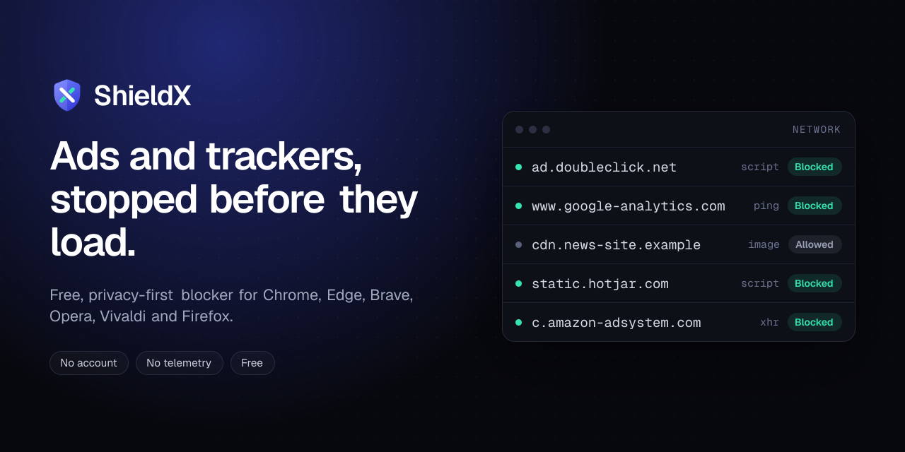

<p align="center">
  
</p>

# ShieldX — Ad & Tracker Blocker

**Latest version: v0.1.2** · Public test release · Free

Privacy-first ad, tracker and security blocker for **Chrome, Edge, Brave, Opera, Vivaldi and Firefox** (Manifest V3).
No account, no analytics, no telemetry. Your settings never leave your device.

This repository hosts ShieldX **downloads** ([Releases](https://github.com/markworldorg/shieldx-releases/releases)) and **bug reports** ([Issues](https://github.com/markworldorg/shieldx-releases/issues)). The extension's source code isn't published here.

> ⚠️ ShieldX is in **public testing**. Only install files downloaded from this repository's [Releases page](https://github.com/markworldorg/shieldx-releases/releases), and check the checksum before installing.

## Download v0.1.2

| Your browser | File to download |
|---|---|
| Chrome, Microsoft Edge, Brave, Opera, Vivaldi | [`ShieldX-v0.1.2-chromium.zip`](https://github.com/markworldorg/shieldx-releases/releases/download/v0.1.2/ShieldX-v0.1.2-chromium.zip) |
| Firefox 128 or newer | [`ShieldX-v0.1.2-firefox.zip`](https://github.com/markworldorg/shieldx-releases/releases/download/v0.1.2/ShieldX-v0.1.2-firefox.zip) |
| Checksums for both | [`SHA256SUMS.txt`](https://github.com/markworldorg/shieldx-releases/releases/download/v0.1.2/SHA256SUMS.txt) |

Older and newer versions are on the [Releases page](https://github.com/markworldorg/shieldx-releases/releases).

### Check your download

The SHA-256 checksums must match:

```
b0053f8b87305f7568b5f7dfff6b7ab7071b502aa0ee24f4ae0adb25430a1bba  ShieldX-v0.1.2-chromium.zip
f9d970a31d92944dccedfa3db151a310543054cb304df52eb3547de9500a8ffc  ShieldX-v0.1.2-firefox.zip
```

- **Linux:** `sha256sum -c SHA256SUMS.txt --ignore-missing`
- **macOS:** `shasum -a 256 ShieldX-v0.1.2-chromium.zip`
- **Windows (PowerShell):** `Get-FileHash .\ShieldX-v0.1.2-chromium.zip -Algorithm SHA256`

## Install: Chrome, Edge, Brave, Opera, Vivaldi

1. Unzip `ShieldX-v0.1.2-chromium.zip` into a folder you'll keep. Your browser loads ShieldX from that folder, so don't delete it.
2. Open your browser's extensions page:

   | Browser | Address |
   |---|---|
   | Chrome | `chrome://extensions` |
   | Edge | `edge://extensions` |
   | Brave | `brave://extensions` |
   | Opera | `opera://extensions` |
   | Vivaldi | `vivaldi://extensions` |

3. Turn on **Developer mode**.
4. Click **Load unpacked** and select the unzipped folder (the one that contains `manifest.json`).
5. Pin ShieldX to your toolbar from the extensions (puzzle-piece) menu. Protection is already on.

**Requirements:** a Chromium-based browser, version 121 or newer, on Windows, macOS, Linux or ChromeOS.

**To update and keep your settings:** unzip the new version over the same folder, then click **Reload** on ShieldX on the extensions page.

**To remove:** click **Remove** on ShieldX on the extensions page. All ShieldX data is deleted along with it.

## Install: Firefox (128 or newer)

Until ShieldX is signed on addons.mozilla.org, test builds install as a **temporary add-on**, which Firefox removes when it restarts.

1. Unzip `ShieldX-v0.1.2-firefox.zip`.
2. Open `about:debugging#/runtime/this-firefox`.
3. Click **Load Temporary Add-on…** and select `manifest.json` inside the unzipped folder.

In Firefox, all blocking, element hiding and YouTube ad blocking work. The blocked-count badge on the icon and the per-tab count in the popup aren't available, because Firefox doesn't support those features.

## What's new in v0.1.2

- **Much stronger blocking:** EasyList and EasyPrivacy are now built in and on by default. That adds tens of thousands of ad, pop-up and tracker rules, plus element hiding for thousands of individual sites.
- **YouTube video ads blocked** (new setting, on by default):
  - ShieldX removes ad breaks from YouTube's player data.
  - Any ad that still starts plays muted at 16× speed while ShieldX presses Skip.
- **More browsers:** one build for Chrome, Edge, Brave, Opera and Vivaldi, and a separate Firefox build.
- **Measured** on [superadblocktest.com](https://superadblocktest.com/) in October 2026: **92%** with default settings, **98%** with Strict protection.

See [CHANGELOG.md](CHANGELOG.md) for every version.

## What ShieldX does

- **Ads:** blocks ad servers, ad exchanges, pop-up and pop-under ad networks, video ad servers and affiliate trackers. This includes the built-in **EasyList**.
- **Trackers:** blocks analytics, session recording, fingerprinting, identity syncing and social-media pixels. This includes the built-in **EasyPrivacy**.
- **Security:** blocks browser cryptominers and malvertising networks, even when a page or pop-up tries to open them directly.
- **Telemetry:** blocks error-reporting services and device-maker tracking endpoints.
- **Ad hiding:** hides the empty boxes ads leave behind, with a per-site off switch.
- **YouTube video ads:** best effort. Some videos take a few seconds longer to start.
- **Your controls:**
  - **Balanced** or **Strict** protection in one click.
  - Pause ShieldX on any site, or only stop hiding ad boxes there.

## Known limitations

- No blocker can stop every ad, and new ad domains appear before filter lists catch them.
- About 1% of community-list filters use syntax that browser blocking engines can't run (regex and scriptlets), so they're skipped.
- YouTube ad blocking depends on YouTube's data format, which changes often. Ads may reappear until ShieldX is updated.
- Audio ads on Spotify and similar services can't be reliably blocked.
- Changing protection for a site takes effect after reloading the page.

## Report a problem

Please **[open an issue](https://github.com/markworldorg/shieldx-releases/issues/new/choose)**, or use **Report a problem** in the ShieldX popup. Include:
- your browser and its version
- the website address
- what you expected to happen

Never include passwords, cookies or personal data.

## Privacy

- **Local storage only:** settings and counters stay in your browser's local extension storage on your device.
- **No browsing data:** blocking is done by the browser's built-in engine, so ShieldX never receives the addresses you visit.
- **Nothing downloaded by default:** the built-in lists ship inside the extension. ShieldX downloads nothing unless you turn on optional live list updates, which come from `easylist.to`.
- **No outside control:** no website can read or change ShieldX settings.

Full policy: [PRIVACY.md](PRIVACY.md)

## Credits

EasyList and EasyPrivacy © The EasyList authors, used under CC BY-SA 3.0.
